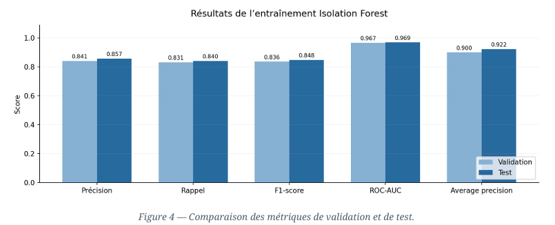
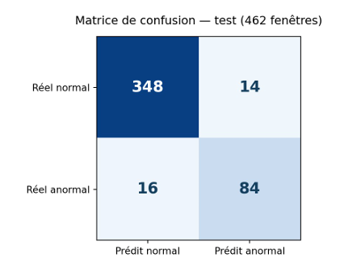

<div align="center">

# 🩺 SmartCare
### IoT-Based Patient Monitoring & Early Warning System

**SUP'COM · Cloud of Things (COT) · 2026–2027 · Team 9**

[](middleware/) [](IoT/) [](middleware/) [](IoT/mlops/) [](#implementation-status)

*An experimental end-to-end platform for physiological measurement ingestion, monitoring, anomaly detection and future early-warning workflows.*

</div>

> [!IMPORTANT]
> **Academic prototype, not a medical device.** Simulated vital signs, anomaly labels and model predictions are for engineering evaluation only, not diagnosis, clinical triage or patient care.

## Contents

- [Overview](#overview)
- [Architecture](#architecture)
- [Implementation status](#implementation-status)
- [MQTT ingestion and reliability](#mqtt-ingestion-and-reliability)
- [MongoDB persistence and ingestion records](#mongodb-persistence-and-ingestion-records)
- [MLOps and experimental results](#mlops-and-experimental-results)
- [Repository layout](#repository-layout)
- [Quick start (Windows PowerShell)](#quick-start-windows-powershell)
- [Backend health API](#backend-health-api)
- [Testing and CI](#testing-and-ci)
- [Security, limitations and roadmap](#security-limitations-and-roadmap)
- [Team and attribution](#team-and-attribution)

## Overview

SmartCare aims to connect a wearable/edge sensing device to a reliable cloud-backed monitoring platform. The **current input is a Python simulator**; an **ESP32 + MAX30102** hardware source is planned. Measurements travel over MQTT through a Node-RED validation gateway, then a Jakarta EE middleware service independently validates and persists them to MongoDB. A separate Python MLOps pipeline has trained and evaluated an anomaly detector; real-time scoring and backend alert integration remain future work.

**Design principles:** backend-owned identity, device ownership and persistence; MQTT QoS 1 with application-level deduplication; separation of validation from anomaly detection; asynchronous ML so ingestion never blocks on inference; browser access through backend APIs rather than direct MQTT.

## Architecture


**Data path implemented in the repository:** `Simulator → Mosquitto → Node-RED → validated MQTT → Jakarta EE receiver → MongoDB`. **Designed but not yet connected:** `ESP32/MAX30102`, live ML scoring, backend alert rules and live PWA adapters. The Python rule-based duration detector exists as an independent component, but its end-to-end integration with the backend is not established.

```mermaid
flowchart LR
    SIM[Python simulator] -->|raw/{deviceId}| MQ[(Mosquitto)]
    ESP[ESP32 + MAX30102<br/>planned] -.-> MQ
    MQ --> NR[Node-RED validation]
    NR -->|validated/{deviceId}| MQ
    NR -->|rejected/{deviceId}| MQ
    MQ -->|validated/#| ING[Jakarta EE MQTT receiver]
    ING --> VAL[Backend revalidation]
    VAL --> REP[MongoDB repository]
    REP --> DB[(MongoDB)]
    MQ -->|validated/+| DET[Duration detector]
    DET -->|detection/events| MQ
    MQ -.-> ML[Real-time ML service<br/>planned]
    ML -.-> API[Alert / score APIs<br/>planned]
    DB -.-> API
    API -.-> UI[Patient & supervision PWAs<br/>demo today]
```

## Implementation status

| Subsystem | Current state | Evidence in repository |
|---|---|---|
| MQTT simulator, seven scenarios | **Implemented** | [`IoT/simulator/`](IoT/simulator/) |
| Mosquitto + Node-RED Docker stack | **Configured** | [`IoT/broker/docker-compose.yml`](IoT/broker/docker-compose.yml) |
| Node-RED raw-message validation and routing | **Implemented** | [`IoT/gateway/flows/flows.json`](IoT/gateway/flows/flows.json) |
| MQTT receiver, revalidation and ingestion counters | **Implemented, integration tests included** | [`middleware/core/.../ingestion/`](middleware/core/src/main/java/com/smartcare/ingestion/) |
| MongoDB schemas, indexes and deduplicated persistence | **Implemented, tests included** | [`middleware/core/.../persistence/`](middleware/core/src/main/java/com/smartcare/persistence/) |
| Health endpoints | **Implemented** | [`middleware/api/`](middleware/api/) |
| Duration-based MQTT anomaly detector | **Implemented as a separate service** | [`IoT/detection/`](IoT/detection/) |
| Synthetic dataset, feature engineering, Isolation Forest | **Implemented; offline evaluation recorded** | [`IoT/mlops/`](IoT/mlops/) |
| MLflow tracking | **Integrated into training script** | [`IoT/mlops/src/train.py`](IoT/mlops/src/train.py) |
| Patient and supervision PWAs | **Demo with in-memory fixtures** | [`frontends/`](frontends/) |
| ESP32/MAX30102 acquisition | **Planned** | Hardware scope |
| Real-time ML inference / persisted scores | **Planned** | Model is trained offline only |
| REST domain endpoints, authentication, alert workflow | **Planned** | [`docs/frontend/api-proposal.md`](docs/frontend/api-proposal.md) |
| Frontend live API integration | **Planned** | Current demo adapters |

## MQTT ingestion and reliability


### MQTT topics

| Topic | Producer → consumer | Purpose |
|---|---|---|
| `smartcare/v1/raw/{deviceId}` | Simulator → gateway | Original sensor reading |
| `smartcare/v1/validated/{deviceId}` | Gateway → middleware / detector | Gateway-accepted reading |
| `smartcare/v1/rejected/{deviceId}` | Gateway → observers | Rejected payload plus reason |
| `smartcare/v1/detection/events` | Duration detector → observers | Rule-based anomaly events |
| `smartcare/v1/status/{deviceId}` | Reserved | Not implemented in the old contract |
| `smartcare/v1/ml/predictions` | Planned ML service | Not yet implemented |

The raw/validated messages use **JSON**, **MQTT QoS 1** and **retain=false**. QoS 1 means *at least once*, not exactly once: duplicate delivery is possible and handled at the application/database layer.

### Example measurement

```json
{
  "schemaVersion": 1,
  "deviceId": "sc-001",
  "bootId": "c0f2e7a5-97bc-4f5b-aed9-859f16c38b6a",
  "sequence": 1,
  "acquiredAtUtc": "2026-11-08T20:00:00Z",
  "heartRate": 78,
  "spo2": 98,
  "quality": "good",
  "reason": null,
  "clockStatus": "synced",
  "source": "simulated"
}
```

`deviceId` identifies a device, `bootId` distinguishes device restarts and `sequence` identifies a logical sample within a boot. The **unique logical ingestion key is `(deviceId, bootId, sequence)`**. The device payload intentionally has **no `patientId`**: ownership is resolved by the backend rather than trusted from an MQTT publisher.

### Validation stages

1. **Gateway:** Node-RED subscribes to `raw/#`, checks the schema version, topic/device match, identifiers, sequence, timestamp, quality, physiological ranges and duplicates/old sequences, then routes to `validated/{deviceId}` or `rejected/{deviceId}`.
2. **Backend:** The MQTT receiver subscribes to `validated/#` and **revalidates** the payload and topic independently. A gateway acceptance is not treated as proof of safety.
3. **Persistence:** `MeasurementRepository` inserts a measurement using the MongoDB unique index. Redeliveries are classified as duplicates instead of creating a second record.
4. **Observability:** `IngestionCounters` tracks `received`, `saved`, `duplicate`, `rejected`, `storeFailed`, connection state, last message time, last rejection reason and rejection counts by reason.

**Important distinction:** Gateway validation is not a clinical rule engine. The duration detector in `IoT/detection/` and the trained Isolation Forest are separate anomaly-analysis components.

### Simulator test scenarios

| Scenario | Intended behavior |
|---|---|
| `normal` | Normal-range HR and SpO₂ |
| `spike` | Short extreme HR spike |
| `sustained` | Persistently elevated HR / reduced SpO₂ |
| `missing` | Sequence gaps without published samples |
| `duplicates` | Repeated logical measurements |
| `disconnect` | MQTT connection interruption / reconnect |
| `invalid` | Null measurements with invalid quality and reason |
| `all` | Run the available scenarios |

Detailed contract and ingestion audit: [`docs/iot/message-contract.md`](docs/iot/message-contract.md) · [`docs/mqtt-ingestion-audit.md`](docs/mqtt-ingestion-audit.md).

## MongoDB persistence and ingestion records

The `middleware/` Maven reactor contains `core` (ingestion and persistence), `iam` (currently scaffolding) and `api` (JAX-RS WAR). `SchemaInitializer` defines database validators and indexes in database `smartcare`.

| Collection | Current purpose |
|---|---|
| `measurements` | Physiological records, with unique index `uq_device_boot_sequence` on `(deviceId, bootId, sequence)` |
| `devices` | Device registry |
| `device_ownership` | Device-to-owner relationships |
| `users` | User records |
| `assignments` | Professional-to-patient assignments |
| `scores`, `alerts`, `audit`, `configuration` | **Planned**, not currently initialized |

**Ingestion outcomes:** a valid new record is saved; a previously seen `(deviceId, bootId, sequence)` is counted as a duplicate; an invalid message is rejected with a reason; a storage error is tracked separately. This is critical because MQTT can retransmit messages after connection failures.

The ingestion health endpoint provides operational counters, **not** a patient history API. The business API for browsing measurements, scores, alerts and ownership is still proposed.

## MLOps and experimental results

### Offline pipeline

```mermaid
flowchart LR
    A[7 simulator scenarios] --> B[3840 synthetic records<br/>210 sessions]
    B --> C[Clean, deduplicate<br/>rolling window = 5]
    C --> D[10 numerical features]
    D --> E[Session-level<br/>train / val / test]
    E --> F[StandardScaler +<br/>Isolation Forest]
    F --> G[Threshold tuned<br/>on validation]
    G --> H[Test metrics + joblib]
    H --> I[MLflow experiment]
    I -.-> J[Real-time MQTT inference<br/>planned]
```



The synthetic dataset was generated from the existing simulator with deterministic seeds and virtual time. The model was trained on **1,638 normal training windows** using `StandardScaler` and `IsolationForest(n_estimators=200, random_state=42)`. Ten features describe rolling heart-rate and SpO₂ windows: means, standard deviations, minima, maxima and deltas. The split is **by session**, not by individual measurement, to reduce leakage.

| Split | Feature windows | Sessions | Anomaly windows |
|---|---:|---:|---:|
| Train | 2,079 | 126 | 441 |
| Validation | 429 | 26 | 89 |
| Test | 462 | 28 | 100 |

The training script chooses a threshold on **validation** (recorded threshold `0.0754979655`) and then evaluates on the held-out test set. Higher anomaly scores indicate more anomalous windows.

### Recorded model performance



| Metric | Validation | Test |
|---|---:|---:|
| Precision | 0.8409 | **0.8571** |
| Recall | 0.8315 | **0.8400** |
| F1-score | 0.8362 | **0.8485** |
| ROC-AUC | 0.9666 | **0.9687** |
| Average precision | 0.8997 | **0.9218** |
| False positives | 14 | 14 |
| False negatives | 15 | 16 |



**Interpretation:** Of 100 anomaly-labeled test windows, 84 were detected and 16 missed; 14 normal windows were flagged incorrectly. These labels come from synthetic scenario/rule generation, so these figures **do not establish clinical sensitivity or generalization to real patients**. The result is an engineering baseline, not a validated medical model.

**Artifacts:** [`IoT/mlops/reports/evaluation.json`](IoT/mlops/reports/evaluation.json), [`IoT/mlops/models/isolation_forest.joblib`](IoT/mlops/models/isolation_forest.joblib). The local joblib bundle stores the estimator, feature ordering and threshold. MLflow logging is implemented in `train.py`; registry deployment and production monitoring are not complete.

**Next ML priorities:** align offline and online window reset behavior for missing/invalid readings, implement real-time inference over validated MQTT, persist model version + score, compare against the duration detector, add data/model lineage and drift monitoring, and validate on more realistic data.

## Repository layout

```text
SmartCare/
├── .github/workflows/ci.yml
├── attribution.md
├── docs/
│   ├── mqtt-ingestion-audit.md
│   ├── frontend/                 # API proposal and access verification
│   ├── iot/                      # message contract, model card, reports
│   ├── prompts/                  # AI-assistance provenance
│   └── assets/                   # README diagrams and result charts (add these)
├── IoT/                          # NOTE: uppercase I and T in uploaded archive
│   ├── broker/                   # Mosquitto + Node-RED Compose
│   ├── gateway/flows/flows.json
│   ├── simulator/                # scenarios and tests
│   ├── detection/                # temporal/duration detector
│   └── mlops/
│       ├── src/                  # generate_dataset, features, preprocess, train
│       ├── data/                 # raw and processed CSVs
│       ├── models/               # local model bundle
│       └── reports/evaluation.json
├── middleware/
│   ├── core/                     # ingestion + MongoDB persistence
│   ├── iam/                      # scaffold
│   └── api/                      # health endpoints + WAR
├── frontends/
│   ├── frontoffice/              # patient demo PWA
│   ├── backoffice/               # staff/admin demo PWA
│   ├── shared/
│   └── tests/
└── scripts/
```

> [!NOTE]
> The **uploaded archive uses `IoT/`**, whereas parts of the older documentation refer to `iot/`. Commands and links in this README use the archive's actual casing. On case-sensitive systems, fix remaining legacy references consistently before running CI.

## Quick start (Windows PowerShell)

### Prerequisites

Docker Desktop, Python 3.12+ for the simulator/MLOps environment, Node.js 22 for frontend tests, Maven 3.9+, the JDK configured for the backend build, WildFly 42, and MongoDB accessible at `localhost:27017`. The older README specifies JDK 25 for the backend CI job.

### 1. Start Mosquitto and Node-RED

```powershell
docker volume create smartcare_nodered_data
docker compose -f IoT/broker/docker-compose.yml up -d
```

Mosquitto is bound to `127.0.0.1:1883`; Node-RED is available at <http://127.0.0.1:1880>. Import `IoT/gateway/flows/flows.json` using Node-RED **Menu → Import**, configure its broker hostname as `smartcare-mosquitto` and deploy.

### 2. Start the simulator

```powershell
py -3 -m venv .venv-simulator
.\.venv-simulator\Scripts\python.exe -m pip install -r IoT/simulator/requirements.txt
.\.venv-simulator\Scripts\python.exe IoT/simulator/simulator.py --scenario normal
```

To observe the gateway output:

```powershell
docker exec -it smartcare-mosquitto mosquitto_sub -h localhost -t "smartcare/v1/validated/#" -t "smartcare/v1/rejected/#" -v
```

### 3. Build and deploy the middleware

Ensure MongoDB is running locally, then:

```powershell
mvn -f middleware/pom.xml clean package
# Set this to your local WildFly 42 installation:
$wildfly = "C:\path\to\wildfly-42.0.0.Final"
& "$wildfly\bin\jboss-cli.bat" --connect --command="deploy $((Resolve-Path 'middleware/api/target/smartcare.war').Path) --force"
```

After WildFly starts, check `http://localhost:8080/smartcare/api/health`, `/health/database` and `/health/ingestion`. The receiver is configured through environment variables; see below.

### 4. Run the frontend demo

```powershell
py -3 -m http.server 8081 --bind 127.0.0.1
```

- Patient PWA: <http://127.0.0.1:8081/frontends/frontoffice/>
- Supervision PWA: <http://127.0.0.1:8081/frontends/backoffice/>

The PWAs currently show **demo data**; successful startup does not imply live backend integration.

### 5. Reproduce the offline ML pipeline

Create a separate environment with the project's ML dependencies (not included as a pinned `requirements.txt` in the uploaded archive), then run:

```powershell
python IoT/mlops/src/generate_dataset.py
python IoT/mlops/src/preprocess.py
# In another terminal, start MLflow tracking:
python -m mlflow server --backend-store-uri sqlite:///mlflow.db --host 127.0.0.1 --port 5000
# With MLflow running:
python IoT/mlops/src/train.py
```

MLflow UI: <http://127.0.0.1:5000>. The model training script expects this tracking endpoint; do not run it without the server unless you change the tracking configuration.

## Backend health API

| Method | URL (WildFly at localhost:8080) | Meaning |
|---|---|---|
| `GET` | `/smartcare/api/health` | Application liveness; expected `{"status":"ok"}` |
| `GET` | `/smartcare/api/health/database` | MongoDB connectivity and schema readiness (200/503) |
| `GET` | `/smartcare/api/health/ingestion` | MQTT receiver connectivity and ingestion counters (200/503) |

### Middleware configuration

| Variable | Default | Purpose |
|---|---|---|
| `MONGODB_URI` | `mongodb://localhost:27017` | MongoDB connection |
| `MONGODB_DATABASE` | `smartcare` | Database |
| `MQTT_ENABLED` | `true` | Enable MQTT receiver |
| `MQTT_BROKER_URL` | `tcp://localhost:1883` | Broker URI |
| `MQTT_TOPIC` | `smartcare/v1/validated/#` | Subscription |
| `MQTT_CLIENT_ID` | `smartcare-middleware` | Receiver client identifier |
| `MQTT_USERNAME`, `MQTT_PASSWORD` | unset | Optional credentials |
| `MQTT_QOS` | `1` | Subscription QoS |
| `MQTT_CLEAN_SESSION` | `false` | Session persistence |
| `MQTT_ACCEPTED_CLOCK_STATUS` | `synced` | Accepted clock states |

See [`middleware/README.md`](middleware/README.md) for further details.

## Testing and CI

```powershell
# Simulator
python -m unittest IoT.simulator.tests.test_simulator -v

# Duration detector
python -m pytest IoT/detection/tests -q

# Frontend
node --test frontends/tests/frontend.test.mjs frontends/tests/access-demo.test.mjs

# Backend (integration tests require MongoDB and Mosquitto)
mvn -f middleware/pom.xml clean verify
```

GitHub Actions is defined in [`.github/workflows/ci.yml`](.github/workflows/ci.yml). The gateway flow is not yet automatically tested end-to-end in CI, and proposed server-side access tests remain blocked until the relevant API endpoints are implemented.

## Security, limitations and roadmap

**Current limitations:** local Mosquitto permits anonymous access and has no TLS; the frontend login is a demo and is not a server-enforced security boundary; real device acquisition is absent; REST domain APIs, score persistence, alert workflows and real-time ML inference are not connected. The synthetic ML evaluation is not medical validation.

**Priority roadmap:** (1) harmonize casing and reproducible environments, (2) automate gateway-to-database end-to-end ingestion tests, (3) integrate real-time MQTT ML scoring with matching feature semantics, (4) persist scores and implement alerts, (5) implement backend authentication, authorization and device ownership checks, (6) connect PWAs to real APIs, (7) validate ESP32/MAX30102 acquisition and secure MQTT, (8) add operational dashboards, drift checks and CI/CD for models.

## Team and attribution

**SUP'COM · COT · Team 9** — Nour Gaïda · Hadil Karous · Nour Shili.

This project uses third-party libraries and AI-assisted development. The required academic integrity declaration, prompt journal and code provenance are maintained in [`attribution.md`](attribution.md). Contributions should be reviewed and updated each sprint.

---

*Built for learning about dependable IoT ingestion, distributed systems, data engineering and MLOps—not for clinical deployment.*
