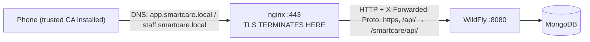

# HTTPS/PWA architecture note

Short entry point; full diagrams and evidence are in [`docs/https-pwa/00-overview.md`](https-pwa/00-overview.md) and [`docs/https-pwa/01-audit.md`](https-pwa/01-audit.md).

- TLS terminates at nginx. WildFly keeps listening on HTTP `8080` behind the proxy.
- Patient app: `https://app.smartcare.local`. Staff app: `https://staff.smartcare.local`. Both use same-origin `/api/...`; no `api.smartcare.local` origin, so no CORS and no cross-subdomain cookie.
- Session cookie `SMARTCARE_SESSION` is host-only, `Secure`, `HttpOnly`, `SameSite=Lax` (target state; current code is `Secure=false`, `SameSite=Strict` — see audit).
- CSRF token is delivered in the login/session JSON and sent back in `X-CSRF-Token`.
- Service workers never cache `/api/`, sessions, CSRF tokens, medical data or exports.

Status: architecture above is PLANNED; only the "current state" section of `00-overview.md` has been verified so far.
