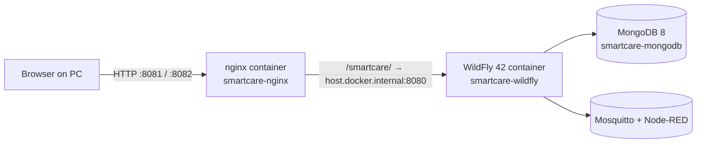
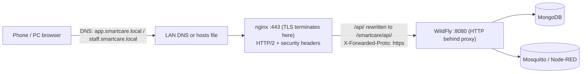

# 00 — HTTPS/PWA rollout overview

## Current state (verified 2026-11-21)



- nginx is an existing container with a bind-mounted config at `docker/nginx-lan.conf`; the repository has **no** nginx Dockerfile or Compose file.
- WildFly is a **container** (`quay.io/wildfly/wildfly:42.0.0.Final-jdk25`) publishing `8080` on the host. It is on a different Docker bridge network from nginx, hence `host.docker.internal:8080`.
- The WAR context root is `/smartcare` (`middleware/api/pom.xml`, `finalName=smartcare`). Frontend runtime modules resolve their API base to the **same-origin `/api/`**, which does not match the deployed `/smartcare/api/` without a proxy rewrite.
- TLS terminates nowhere today. Cookies are `HttpOnly`, `SameSite=Strict`, `Secure=false` by default.

## Target state (PLANNED — UNVERIFIED until Phase B/C are executed)



Two separate origins, one per app, avoid cross-portal cookie and service-worker scope collisions:
`https://app.smartcare.local` (patient) and `https://staff.smartcare.local` (staff). `api.smartcare.local` is an optional convenience alias only; it is deliberately not used by the apps because same-origin `/api/` keeps the session cookie host-only and removes CORS/preflight concerns.

## Login and CSRF sequence (target)

```mermaid
sequenceDiagram
    participant B as Installed PWA
    participant N as nginx :443
    participant W as WildFly /smartcare/api
    participant M as MongoDB
    B->>N: POST /api/auth/login (same-origin)
    N->>W: POST /smartcare/api/auth/login + X-Forwarded-Proto: https
    W->>M: verify PBKDF2 hash, create session
    W-->>B: Set-Cookie SMARTCARE_SESSION (Secure; HttpOnly; SameSite=Strict), csrfToken in JSON
    B->>N: GET /api/session (cookie)
    N->>W: GET /smartcare/api/session
    W-->>B: userId, role, csrfToken
    B->>N: POST /api/auth/logout + X-CSRF-Token
    W-->>B: 204 + expired cookie
```

## Service worker caching policy (target)

| Request | Strategy | Cache |
| --- | --- | --- |
| Navigation | network-first, fallback to cached shell / `offline.html` | app shell only |
| Hashed/static asset | stale-while-revalidate | static cache |
| `/api/*` | network only | **never** |
| Non-GET | network only | **never** |

See [01-audit.md](01-audit.md) for the evidence behind this plan.
