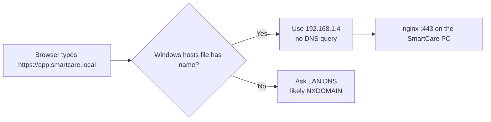

# 02 — Local hostnames (`*.smartcare.local`)

## Goal
- Make the PC/browser resolve `app.smartcare.local`, `staff.smartcare.local`, and optional `api.smartcare.local` to the SmartCare LAN IP before any TLS work starts.
- Change only the Windows hosts file; do not install DNS software, change router settings, or require elevated privileges from the AI agent.

## Plain-language explanation
- A browser asks DNS to turn a name like `app.smartcare.local` into an IP address. On a lab LAN there is usually no DNS record for that made-up name.
- Windows checks a local text file (`C:\Windows\System32\drivers\etc\hosts`) **before** asking DNS. Adding three lines there makes the names work on the PC only.
- Phones still need a real LAN DNS server; that is Phase D (dnsmasq) or the optional cloudflared tunnel. This step deliberately does not solve phones.
- The script is idempotent: running it twice produces the same file, backs up the original once, and `-Remove` restores the unmanaged state.



## Why it is needed here
- A PWA install is tied to an origin (scheme + host + port). HTTP `http://192.168.1.4:8081` and HTTPS `https://app.smartcare.local` are different origins; cookies, service workers and manifests do not carry over.
- Two hostnames give the patient and staff apps separate service-worker scopes even though both are served by the same nginx process.
- `mkcert` can issue a certificate covering the whole suffix, so adding a hostname later does not require a new certificate.

## Prerequisites
- Windows with PowerShell 5.1 or later.
- The SmartCare PC LAN IPv4 address. Default assumed by this step: `192.168.1.4`. Confirm with `ipconfig | findstr IPv4`.
- An **administrator** PowerShell window. The AI agent will not elevate itself.
- Repository checked out at `<REPO>` (or replace the path with your own clone).
- Nothing from B2–B6 has been run yet.

## Procedure
1. Open **Windows Terminal (Admin)**: right-click the Start button → *Windows Terminal (Admin)* → approve the UAC prompt. The title bar should say *Administrator*.
2. Paste these two lines exactly, replacing the path if your clone lives elsewhere:

   ```powershell
   Set-Location '<REPO>'
   PowerShell -NoProfile -ExecutionPolicy Bypass -File .\scripts\setup-hosts.ps1 -IpAddress 192.168.1.4
   ```

3. You should see a backup message on the first run and three hostnames printed. Re-running the same command is safe.
4. If the LAN IP is different, re-run with the corrected value, e.g. `-IpAddress 192.168.1.23`. The script overwrites only its own managed block.
5. Paste the full terminal output into `docs/https-pwa/evidence/2026-11-21-hostnames.txt` where the template says `PASTE OUTPUT HERE`.
6. To roll back at any time, run the same command with `-Remove`:

   ```powershell
   PowerShell -NoProfile -ExecutionPolicy Bypass -File .\scripts\setup-hosts.ps1 -IpAddress 192.168.1.4 -Remove
   ```

7. Do **not** run `mkcert -install` yet; that is B2 and also needs your administrator window.

## Files created or modified
- `scripts/setup-hosts.ps1` — new idempotent, admin-required hosts-file helper.
- `docs/https-pwa/README.md` — new step index linking B1–D.
- `docs/https-pwa/02-hostnames.md` — this step document.
- `docs/https-pwa/evidence/2026-11-21-hostnames.txt` — evidence template; still `UNVERIFIED`.
- `docs/https-pwa/screenshots-todo.md` — two placeholder rows added.
- `docs/decisions/ADR-0001-local-hostnames.md` — decision record for hosts file over dnsmasq/tunnel.
- `docs/https-pwa/00-overview.md` — corrected the target SameSite value to `Strict` and clarified the optional API alias.
- `docs/CHANGELOG.md` — added step A/B1 rows.

## Verification
- **Status: UNVERIFIED** — the script was written but not executed because it requires administrator privileges.
- After you run the command, paste outputs into the evidence file:

  ```powershell
  nslookup app.smartcare.local
  nslookup staff.smartcare.local
  nslookup api.smartcare.local
  Select-String -Path "$env:WINDIR\System32\drivers\etc\hosts" -Pattern 'smartcare.local'
  ```

- Expected result for each name: `Address: 192.168.1.4` (or your chosen IP). The hosts-file lines are inside the `# >>> SmartCare HTTPS` / `# <<< SmartCare HTTPS` markers and are not duplicated.
- Test the negative case: `nslookup app.smartcare.local 8.8.8.8` should fail or return a public answer, proving the local override is what works.
- Do not test `https://...` yet; nginx HTTPS does not exist until B3.

## Troubleshooting

| Problem | Likely cause | Fix |
| --- | --- | --- |
| `Run this from an elevated PowerShell...` | Terminal was not started as Administrator. | Close it and reopen with *Windows Terminal (Admin)*; approve UAC. |
| `Access to the path ... hosts is denied` | Antivirus/EDR or missing admin token. | Confirm the title says *Administrator*; temporarily allow the script in endpoint protection; if still blocked, edit the hosts file manually as admin and paste a screenshot. |
| `nslookup` still resolves to something else | DNS cache, VPN, or a wildcard DNS override. | Run `ipconfig /flushdns`; disconnect VPN; run `nslookup app.smartcare.local 127.0.0.1` to force the hosts file. |
| Duplicate lines after several runs | An older manual entry used a different spelling. | Run `-Remove`, then inspect with `Select-String 'smartcare'` and delete leftovers manually. |
| Phone cannot resolve the names | Hosts file affects only the PC. | Expected in B1. Use Phase D dnsmasq/tunnel; do not add phone-specific hacks here. |

Also appended to [14-troubleshooting.md](14-troubleshooting.md).

## Security notes
- The hosts file is local and world-readable; it contains no secrets, only names and an IP.
- The script backs up the original once to `hosts.bak`; that backup is outside the repository and is never committed.
- No certificate material is created or read here. `rootCA-key.pem` remains untouched and must never be copied.
- Using a `.local` suffix with a hosts file is a lab convention; it does not configure multicast DNS and does not leak names to public DNS.

## Rollback
- Run the script with `-Remove`, then `ipconfig /flushdns`.
- Optionally restore `C:\Windows\System32\drivers\etc\hosts.bak` over the hosts file from an elevated shell.
- Delete the evidence screenshots if the rollout is abandoned; no application code depends on this step.

## Decisions and alternatives
- Accepted [ADR-0001](../decisions/ADR-0001-local-hostnames.md): hosts file now, dnsmasq/cloudflared in documentation only.
- Alternative: router DNS/dnsmasq gives phones resolution too, but needs router admin access and is Phase D.
- Alternative: `nip.io`/`sslip.io` names need no hosts edit but put a public-looking name in browser history and complicate mkcert coverage.
- Alternative: cloudflared tunnel works from phones without LAN DNS but exposes a demo publicly; deferred per decision D12.

## References
- Microsoft Learn — hosts file: https://learn.microsoft.com/en-us/windows-server/administration/windows-commands/hosts-file
- Microsoft Learn — `ipconfig`: https://learn.microsoft.com/en-us/windows-server/administration/windows-commands/ipconfig
- Microsoft Learn — PowerShell execution policies: https://learn.microsoft.com/en-us/powershell/module/microsoft.powershell.security/about/about_execution_policies
