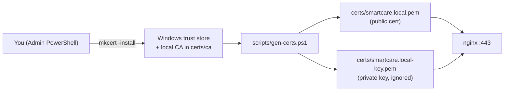

# 03 — Local CA and wildcard certificate (`mkcert`)

## Goal
- Create a locally trusted certificate authority (CA) and one wildcard certificate covering `smartcare.local` and `*.smartcare.local`, so both HTTPS hosts work without browser warnings.
- Keep every private key out of git.

## Plain-language explanation
- A normal public CA will not issue certificates for a made-up `.local` name on a laptop. `mkcert` creates a tiny CA on this PC, adds it to the local trust store, and signs a certificate for our names.
- `mkcert -install` needs administrator rights and shows a UAC prompt. The AI agent does not elevate itself, so **you** run that one command.
- The CA files live in `certs/ca/`. The leaf certificate and key live in `certs/`. A `.gitignore` rule ignores all of them, except `certs/README.md` and `certs/.gitkeep`.
- One wildcard certificate is reused by both nginx server blocks; that is safe because the private key never leaves this PC.



## Why it is needed here
- Browsers refuse to install a PWA from an untrusted HTTPS origin; a self-signed leaf certificate would require an exception on every device.
- A wildcard certificate means an additional lab hostname later does not require new trust material.
- Storing the CA under the repo (but git-ignored) makes the whole setup reproducible on another PC: copy the repo, run `mkcert -install` again, regenerate leaf certificate.

## Prerequisites
- B1 completed: hostnames resolve to the PC IP.
- `mkcert` installed: `mkcert -version` → `v1.4.4` verified 2026-11-21.
- Administrator PowerShell available for `mkcert -install` (UAC prompt).
- `git` on PATH (used by the script to prove certificate files are ignored).
- No certificate files should currently exist in `certs/`.

## Procedure
1. In an **elevated** PowerShell, run:

   ```powershell
   Set-Location 'C:\Users\SINORFI\Desktop\SmartCare'
   $env:CAROOT = (Resolve-Path .\certs\ca).Path
   mkcert -install
   ```

2. Approve the UAC prompt. Expected output mentions `Created a new local CA` and `The local CA is now installed in the system trust store`.
3. In the **same** elevated window (so `$env:CAROOT` is still set), generate the leaf certificate:

   ```powershell
   PowerShell -NoProfile -ExecutionPolicy Bypass -File .\scripts\gen-certs.ps1
   ```

4. Expected output includes four ignored paths, a SHA256 file hash, and SANs `smartcare.local, *.smartcare.local, localhost, 127.0.0.1, ::1`.
5. Confirm git ignores the secret files:

   ```powershell
   git check-ignore -v -- certs/smartcare.local-key.pem certs/ca/rootCA-key.pem
   git status --short --ignored --untracked-files=all certs
   ```

   Only `certs/.gitkeep` and `certs/README.md` should appear as untracked.
6. Paste the two command outputs and the SHA256 hash into `docs/https-pwa/evidence/2026-11-21-mkcert.txt`. **Never** paste key contents.
7. Leave `certs/ca/rootCA.pem` available for Phase D phone installation. Copy only that file to a phone; never copy `rootCA-key.pem`.

## Files created or modified
- `.gitignore` — ignore `*.pem`, `*.key`, `*.crt`, `*.csr`, `*.pfx`, `*.p12`, `rootCA*`, `certs/*`; allow only `certs/README.md` and `certs/.gitkeep`.
- `scripts/gen-certs.ps1` — new certificate generator with ignore-check and restricted key ACL.
- `certs/README.md` — committed warning and manual commands.
- `certs/.gitkeep` — keeps the ignored directory visible in the repository.
- `docs/https-pwa/03-local-certificates.md` — this step document.
- `docs/https-pwa/evidence/2026-11-21-mkcert.txt` — evidence template; still `UNVERIFIED`.
- `docs/decisions/ADR-0002-mkcert-local-ca.md` — decision record.
- `docs/https-pwa/screenshots-todo.md` — one placeholder row.
- `docs/https-pwa/README.md`, `docs/CHANGELOG.md` — index/status updates.

## Verification
- **Status: UNVERIFIED** — requires user UAC; no CA or certificate was generated by the AI agent.
- After running the commands, paste outputs into the evidence file.
- Automated checks the script performs itself:
  - `mkcert` on PATH.
  - `certs/ca/rootCA.pem` exists (proves `mkcert -install` ran with the right `CAROOT`).
  - `git check-ignore` succeeds for both leaf files and both CA files.
  - Leaf SHA256 file hash is printed for evidence.
- Manual checks after generation:

  ```powershell
  mkcert -CAROOT
  Get-ChildItem certs -Recurse | Select-Object FullName, Length
  git status --short --ignored --untracked-files=all certs
  ```

- Expected `mkcert -CAROOT` output: the absolute path to `certs\ca`.
- Do not try `curl https://app.smartcare.local` yet; nginx HTTPS is created in B3.

## Troubleshooting

| Problem | Likely cause | Fix |
| --- | --- | --- |
| `mkcert not found` | Chocolatey install directory not on PATH. | Run `choco install mkcert -y`, reopen PowerShell, or call `C:\ProgramData\chocolatey\bin\mkcert.exe` directly. |
| `Local CA not trusted yet` | `mkcert -install` was run in a different shell without `$env:CAROOT`. | Set `$env:CAROOT` to `certs\ca` in the elevated window, run `mkcert -install`, then re-run the generator in that same window. |
| UAC prompt declined or no admin rights | Standard user token. | Ask the machine owner to run the two commands; the AI agent must not elevate. |
| `... is NOT ignored by git` | `.gitignore` changed or command run from wrong directory. | Stop, restore the patterns shown in `certs/README.md`, re-run from repository root. |
| Browser still warns after B3 | Firefox uses its own trust store, or CA installed under default CAROOT. | Set `TRUST_STORES=system,java,nss` before `mkcert -install`; check `mkcert -CAROOT`. |

Also appended to [14-troubleshooting.md](14-troubleshooting.md).

## Security notes
- `rootCA-key.pem` is the most sensitive file in this setup. It stays in `certs/ca/`, is git-ignored, and is never pasted into evidence or chat.
- The leaf key is restricted with `icacls` to the current user and is git-ignored.
- The SHA256 printed by the script is a **file hash for evidence**, not a secret and not the certificate fingerprint.
- Trusting a local CA is equivalent to trusting this PC for local names; uninstall with `mkcert -uninstall` when the lab is retired.
- Do not reuse this CA on a public server or install it on phones outside the lab.

## Rollback
- Run `mkcert -uninstall` with the same `$env:CAROOT`.
- Delete `certs/smartcare.local.pem`, `certs/smartcare.local-key.pem` and the whole `certs/ca/` folder.
- Restore `.gitignore` from git if the rollout is abandoned; committed `certs/README.md` and `.gitkeep` are harmless.

## Decisions and alternatives
- Accepted [ADR-0002](../decisions/ADR-0002-mkcert-local-ca.md): mkcert with wildcard local CA, manual UAC by user.
- Alternative: plain OpenSSL self-signed certificate — no trust store, browser warnings, poor PWA demo.
- Alternative: public CA/Let's Encrypt — cannot issue for `.local` without a public domain and DNS control.
- Alternative: install mkcert CA into default user CAROOT — rejected so the CA lives beside the repo and can be removed cleanly.

## References
- mkcert README: https://github.com/FiloSottile/mkcert
- mkcert trust-store options: https://github.com/FiloSottile/mkcert#using-the-ca-on-other-machines
- Microsoft Learn — UAC: https://learn.microsoft.com/en-us/windows/security/application-security/application-control/user-account-control/how-user-account-control-works
