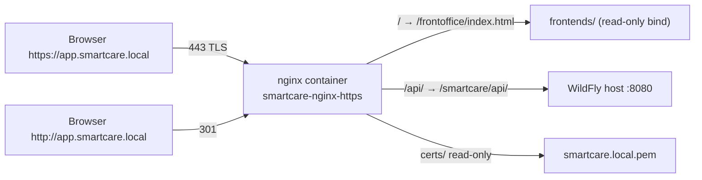

# 04 — nginx HTTPS reverse proxy

## Goal
- Serve both PWAs from trusted HTTPS origins on port 443 (`app.smartcare.local`, `staff.smartcare.local`), redirect HTTP to HTTPS, and proxy `/api/` to the existing WildFly without changing its context root.
- Leave the legacy HTTP containers/config on 8081/8082 untouched.

## Plain-language explanation
- nginx terminates TLS: the browser talks HTTPS to nginx, then nginx talks plain HTTP to WildFly on `host.docker.internal:8080` inside the container network.
- Each hostname gets its own `server` block. Both use the same wildcard certificate from B2.
- Because the frontends import modules from `../shared/` and the staff CSS comes from `../frontoffice/`, nginx mounts the whole `frontends/` directory at `/usr/share/nginx/html` and exposes sibling paths (`/shared/`, `/frontoffice/`, `/backoffice/`) directly. The app's own files are mapped to `/` by `try_files`.
- The browser calls `/api/...`. nginx rewrites that to WildFly's real `/smartcare/api/...` by using `proxy_pass http://host.docker.internal:8080/smartcare/api/;`. This avoids CORS and keeps `SMARTCARE_SESSION` host-only.
- Strict CSP and a 5-minute HSTS header are added on every response. HSTS deliberately has no `includeSubDomains` or `preload`.



## Why it is needed here
- PWA install prompts only appear for secure contexts; `http://192.168.1.4:8081` is not secure.
- Separate hostnames avoid service-worker and manifest scope collisions between patient and staff apps.
- Same-origin `/api/` means no CORS, no preflight, no cross-subdomain cookie, and no changes to WildFly's `/smartcare` context root (decision D1).
- The new Compose file is additive; the old `docker/nginx-lan.conf` container can keep running on 8081/8082 until Phase C cutover.

## Prerequisites
- B1 hostnames resolve to the PC IP.
- B2 certificate files exist at `certs/smartcare.local.pem` and `certs/smartcare.local-key.pem`.
- Docker Engine + Compose v5.1.1 verified; port 80 and 443 are free.
- WildFly still publishes `0.0.0.0:8080->8080/tcp`; it can be stopped for static checks but must be running for API checks in B6.
- Do not remove `smartcare-nginx` yet; it owns the legacy 8081/8082 demo.

## Procedure
1. Review the new files: `docker/nginx-https.conf` and `docker/compose.https.yml`.
2. Validate the Compose model (does not need certificates or a running daemon):

   ```powershell
   docker compose -f docker/compose.https.yml config
   ```

3. Check nginx syntax with the real certificate files mounted:

   ```powershell
   docker run --rm `
     -v "${PWD}\docker\nginx-https.conf:/etc/nginx/conf.d/default.conf:ro" `
     -v "${PWD}\frontends:/usr/share/nginx/html:ro" `
     -v "${PWD}\certs:/etc/nginx/certs:ro" `
     nginx:stable nginx -t
   ```

4. Start only the new HTTPS proxy:

   ```powershell
   docker compose -f docker/compose.https.yml up -d
   docker compose -f docker/compose.https.yml logs -f nginx
   ```

5. Stop it with `docker compose -f docker/compose.https.yml down` if needed; this does not touch `smartcare-nginx`.
6. Paste the `config`, `nginx -t`, and `up` outputs into `docs/https-pwa/evidence/2026-11-21-nginx-tls.txt`.
7. Screenshot the Chrome padlock on `https://app.smartcare.local` after B6 and save as `docs/img/03-certificate-padlock.png`.

## Files created or modified
- `docker/nginx-https.conf` — new HTTP redirect, two TLS server blocks, strict CSP/HSTS, `/api/` rewrite, cache rules, sibling-path mounts.
- `docker/compose.https.yml` — new nginx-only Compose service on 80/443 with cert/frontend binds and `host.docker.internal:host-gateway`.
- `frontends/frontoffice/styles.css`, `frontends/backoffice/sw.js`, `frontends/frontoffice/sw.js` — removed third-party font import, added local `@font-face` rules, precached fonts, bumped static cache versions.
- `frontends/frontoffice/fonts/*.woff2`, `frontends/backoffice/fonts/*.woff2` — four self-hosted variable-font subsets per app (DM Sans v17 latin/latin-ext, Manrope v23 latin/latin-ext).
- `frontends/tests/frontend.test.mjs` — allow `woff2` in the SW static allowlist assertion.
- `attribution.md` — recorded font versions, OFL licences, Lighthouse/mkcert/Compose versions.
- `docs/https-pwa/04-nginx-tls.md` — this step document.
- `docs/https-pwa/evidence/2026-11-21-nginx-tls.txt` — evidence; static checks recorded, live HTTPS `UNVERIFIED`.
- `docs/decisions/ADR-0003-tls-termination.md`, `ADR-0004-same-origin-api.md`, `ADR-0005-nginx-only-compose.md` — decision records.
- `docs/https-pwa/README.md`, `docs/https-pwa/14-troubleshooting.md`, `docs/CHANGELOG.md` — index/troubleshooting/log updates.

## Verification
- **Recorded as verified on 2026-11-21**:
  - `docker compose -f docker/compose.https.yml config` → valid, source paths resolve to `<REPO>\docker\nginx-https.conf`, `<REPO>\frontends`, `<REPO>\certs`.
  - `nginx -t` in `nginx:stable` with a throwaway self-signed certificate in `<TEMP>` (outside the repo, deleted afterwards) → `syntax is ok` / `test is successful`.
  - `node --test frontends/tests/frontend.test.mjs` → 26 tests, 26 pass, 0 fail after adding `woff2` to the SW allowlist assertion.
- **UNVERIFIED until you run B2 and start the service**:
  - `nginx -t` with the real mkcert files.
  - `docker compose -f docker/compose.https.yml up -d`.
  - `curl.exe -I http://app.smartcare.local/` → `301` to `https://app.smartcare.local/`.
  - `curl.exe -I https://app.smartcare.local/` and `https://staff.smartcare.local/` → `200`, padlock, `strict-transport-security: max-age=300`.
  - `curl.exe -k -s -o NUL -w "%{http_code}" https://app.smartcare.local/api/health` → reaches WildFly (expected JSON or 404 from the backend, not nginx 502).
- Security-header smoke check after startup:

  ```powershell
  curl.exe -sSI https://app.smartcare.local/ | Select-String -Pattern 'strict-transport-security|content-security-policy|cache-control'
  ```

- Expected CSP is exactly:
  `default-src 'self'; script-src 'self'; style-src 'self'; img-src 'self' data:; connect-src 'self'; font-src 'self'; manifest-src 'self'; worker-src 'self'; frame-ancestors 'none'; base-uri 'self'; form-action 'self'`

## Troubleshooting

| Problem | Likely cause | Fix |
| --- | --- | --- |
| `nginx: [emerg] cannot load certificate ...` | B2 not run or `CAROOT` mismatch. | Run `scripts/gen-certs.ps1`; confirm `certs/smartcare.local.pem` exists and `docker compose config` mounts `<REPO>\certs`. |
| `bind: address already in use` for 80/443 | IIS, Apache, or another proxy owns the ports. | `netstat -ano | findstr :443`; stop the owner or change published ports only with a new ADR. |
| `502 Bad Gateway` on `/api/` | WildFly not running or `host.docker.internal` mapping missing. | `docker ps` for `smartcare-wildfly`; `docker compose -f docker/compose.https.yml config` must show `host.docker.internal=host-gateway`. |
| Staff page has unstyled content | `/frontoffice/styles.css` not reachable from staff origin. | Confirm `location ^~ /frontoffice/` exists and `<REPO>\frontends` is mounted read-only. |
| Browser blocks self-hosted fonts | CSP `font-src 'self'` or missing files. | Check `curl.exe -I https://app.smartcare.local/fonts/dm-sans-latin-v17.woff2`; both `fonts/` folders must be mounted read-only. |

Also appended to [14-troubleshooting.md](14-troubleshooting.md).

## Security notes
- TLS terminates at nginx; WildFly remains HTTP-only on the host and is not exposed through a second public hostname.
- Certificate and key are mounted read-only from git-ignored `certs/`.
- HSTS is intentionally short (`max-age=300`) with no subdomain/preload so a lab mistake is recoverable.
- Strict CSP blocks inline scripts, third-party fonts, frames, and non-origin API calls. If a demo needs an exception, prove it in B6 and update the ADR rather than silently loosening.
- `server_tokens off` hides the nginx version.
- `/api/` uses `^~` so a static-file regex can never intercept an API request.

## Rollback
- `docker compose -f docker/compose.https.yml down` stops only the new container; 8081/8082 keep working.
- Delete `docker/nginx-https.conf` and `docker/compose.https.yml` if abandoning Phase B; no application files were changed in this step.
- Restore `docs/` entries from git if the ADRs are rejected.

## Decisions and alternatives
- [ADR-0003](../decisions/ADR-0003-tls-termination.md): TLS at nginx, not WildFly.
- [ADR-0004](../decisions/ADR-0004-same-origin-api.md): same-origin `/api/` rewrite; no context-root change.
- [ADR-0005](../decisions/ADR-0005-nginx-only-compose.md): nginx-only Compose, no shared network yet.
- Alternative: put both apps under paths on one origin — rejected because service workers and cookies would share a scope.
- Alternative: expose `api.smartcare.local` — rejected because it would make the cookie cross-subdomain and require CORS.

## References
- nginx docs — `proxy_pass`: https://nginx.org/en/docs/http/ngx_http_proxy_module.html#proxy_pass
- nginx docs — `add_header`: https://nginx.org/en/docs/http/ngx_http_headers_module.html#add_header
- nginx docs — `http2` module: https://nginx.org/en/docs/http/ngx_http_v2_module.html
- MDN — Strict-Transport-Security: https://developer.mozilla.org/en-US/docs/Web/HTTP/Reference/Headers/Strict-Transport-Security
- MDN — Content-Security-Policy: https://developer.mozilla.org/en-US/docs/Web/HTTP/Reference/Headers/Content-Security-Policy
- Docker Compose docs — `extra_hosts`: https://docs.docker.com/reference/compose-file/services/#extra_hosts
