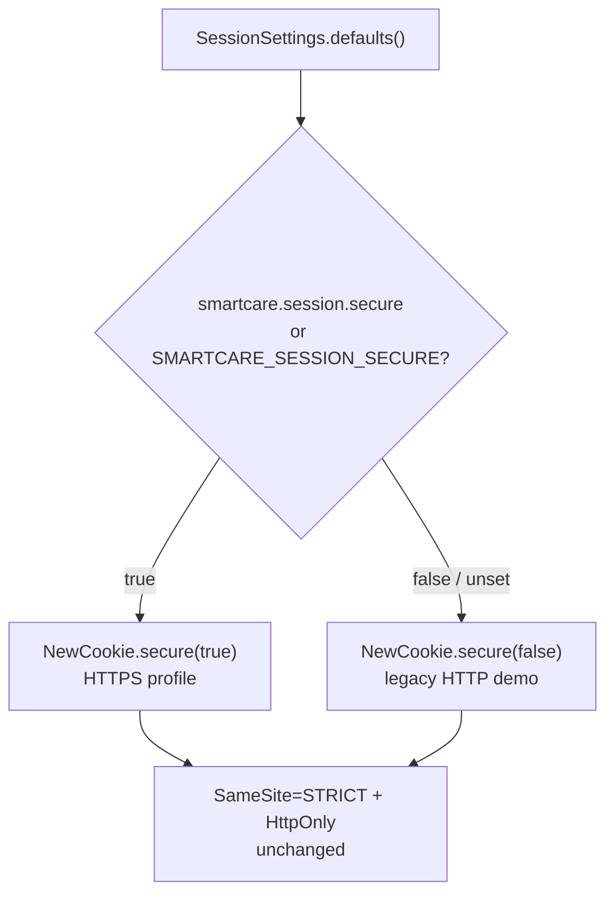

# 05 — Secure session cookie (HTTPS profile)

## Goal
- Make `SMARTCARE_SESSION` carry the `Secure` attribute when WildFly runs behind HTTPS, while keeping the legacy HTTP demo usable.
- Keep `HttpOnly`, `SameSite=Strict`, `Path=/`, the cookie name, and all session lifetimes unchanged.

## Plain-language explanation
- `Secure` tells the browser: “only send this cookie over HTTPS”. On `https://app.smartcare.local` that is exactly what we want.
- On the old `http://192.168.1.4:8081` demo a `Secure` cookie would not be sent after login, so the demo would immediately look logged out. Therefore `Secure` is off by default and switched on only in the HTTPS profile.
- The switch is a JVM system property `smartcare.session.secure` or an environment variable `SMARTCARE_SESSION_SECURE`; the property wins if both are set.
- `SameSite=Strict` remains because the frontend calls `/api/` on the same origin. A cross-origin API host would need `SameSite=None`; that design is explicitly rejected (ADR-0004).



## Why it is needed here
- Without `Secure`, a browser could send the session cookie over plain HTTP if the user reaches the app by IP/port.
- The cookie is host-only and the app is same-origin, so `Strict` is both sufficient and stronger than `Lax`.
- Making the setting configurable avoids a single code path that breaks either the legacy demo or the new HTTPS demo.

## Prerequisites
- JDK 25 via `$env:JAVA_HOME='C:\Program Files\Amazon Corretto\jdk25.0.5_0'`.
- MongoDB reachable on `localhost:27017` (`smartcare-mongodb` running).
- B3 nginx config exists; B4 does **not** require certificates or nginx to be running.

## Procedure
1. Inspect `middleware/iam/src/main/java/com/smartcare/iam/session/SessionSettings.java`. It now reads:
   - system property `smartcare.session.secure`
   - environment variable `SMARTCARE_SESSION_SECURE`
   - default `false`
2. Inspect `middleware/api/src/main/java/com/smartcare/api/auth/AuthResource.java:57-67`. `NewCookie.Builder` still sets `httpOnly(true)` and `sameSite(STRICT)`; only `.secure(settings.secureCookie())` is now data-driven.
3. Run the focused IAM tests:

   ```powershell
   $env:JAVA_HOME = 'C:\Program Files\Amazon Corretto\jdk25.0.5_0'
   mvn --batch-mode --no-transfer-progress -f middleware/pom.xml -pl iam -am test
   ```

4. Expected: `SessionSettingsTest` 3 tests pass; IAM module 14 tests pass; core 54 tests pass; `BUILD SUCCESS`.
5. For the HTTPS WildFly image in B5, set `SMARTCARE_SESSION_SECURE=true` (or `-Dsmartcare.session.secure=true` in `JAVA_OPTS_APPEND`). Do **not** set it on the legacy container.
6. Paste the summary into `docs/https-pwa/evidence/2026-11-21-session-cookie.txt`.
7. In B6, verify the live `Set-Cookie` header contains `Secure; HttpOnly; SameSite=Strict`.

## Files created or modified
- `middleware/iam/src/main/java/com/smartcare/iam/session/SessionSettings.java` — configurable `secureCookie` with property/env fallback, default false.
- `middleware/iam/src/test/java/com/smartcare/iam/session/SessionSettingsTest.java` — three tests for unset/false/true.
- `docs/https-pwa/05-session-cookie-security.md` — this step document.
- `docs/https-pwa/evidence/2026-11-21-session-cookie.txt` — Maven output evidence.
- `docs/decisions/ADR-0006-session-cookie.md` — decision record for `Strict` + configurable `Secure`.
- `docs/https-pwa/README.md`, `docs/https-pwa/14-troubleshooting.md`, `docs/CHANGELOG.md` — index/troubleshooting/log updates.

## Verification
- **VERIFIED 2026-11-21** with MongoDB running and JDK 25:

  ```text
  mvn --batch-mode --no-transfer-progress -f middleware/pom.xml -pl iam -am test
  core: Tests run: 54, Failures: 0, Errors: 0, Skipped: 0
  iam:  Tests run: 14, Failures: 0, Errors: 0, Skipped: 0
        (SessionSettingsTest: 3 tests)
  BUILD SUCCESS
  ```

- First attempt failed with `invalid accessor method in record ... (accessor method must be public)` because the private helper was named `secureCookie()`; renamed to `readSecureCookie()`. Final run passes.
- **UNVERIFIED until B6**: live header on `https://app.smartcare.local/api/auth/login` contains `Secure; HttpOnly; SameSite=Strict`.
- **UNVERIFIED until B5**: HTTPS-profile WildFly actually starts with `SMARTCARE_SESSION_SECURE=true`.

## Troubleshooting

| Problem | Likely cause | Fix |
| --- | --- | --- |
| `invalid accessor method in record` | Helper method named like a record component. | Use a different name, e.g. `readSecureCookie()`. |
| Login works but user is logged out immediately on legacy HTTP | `Secure=true` set globally. | Remove `SMARTCARE_SESSION_SECURE` / property from the legacy container; keep it only in the HTTPS profile. |
| Cookie lacks `Secure` on HTTPS | WildFly started without the property/env, or old image still running. | Recreate the WildFly container with `SMARTCARE_SESSION_SECURE=true`; check startup logs. |
| `MongoTimeoutException` during tests | MongoDB stopped. | `docker start smartcare-mongodb`; rerun with JDK 25. |
| Maven uses Java 17 | `JAVA_HOME` not overridden. | `$env:JAVA_HOME='C:\Program Files\Amazon Corretto\jdk25.0.5_0'`. |

Also appended to [14-troubleshooting.md](14-troubleshooting.md).

## Security notes
- `Secure` and `HttpOnly` are independent: `HttpOnly` blocks JavaScript access, `Secure` blocks plaintext transmission.
- `SameSite=Strict` blocks the cookie on cross-site navigation; no cross-site flow exists because `/api/` is same-origin.
- The setting is read once when `SessionSettings.defaults()` is called at startup; changing the env var requires a WildFly restart/reload.
- Never paste real session IDs or CSRF tokens into evidence; B6 uses demo accounts only.
- Setting `Secure=true` on plain HTTP is a deliberate broken state for the legacy demo, not a fallback.

## Rollback
- Remove `smartcare.session.secure` / `SMARTCARE_SESSION_SECURE`; defaults return to `Secure=false`.
- Restore `SessionSettings.java` and delete `SessionSettingsTest.java` from git if the whole step is abandoned.
- The cookie shape on the legacy demo is unchanged, so no browser data cleanup is needed.

## Decisions and alternatives
- Accepted [ADR-0006](../decisions/ADR-0006-session-cookie.md): keep `Strict`, make `Secure` profile-driven.
- Alternative: `SameSite=Lax` — rejected because nothing needs cross-site top-level navigation; `Strict` is stronger.
- Alternative: `SameSite=None; Secure` — rejected because there is no cross-origin API (ADR-0004).
- Alternative: derive `Secure` from `X-Forwarded-Proto` at runtime — rejected; explicit profile config is auditable and avoids trusting a spoofable header.

## References
- MDN — Set-Cookie `Secure`: https://developer.mozilla.org/en-US/docs/Web/HTTP/Reference/Headers/Set-Cookie#secure
- MDN — Set-Cookie `SameSite`: https://developer.mozilla.org/en-US/docs/Web/HTTP/Reference/Headers/Set-Cookie#samesitesamesite-value
- Jakarta REST — `NewCookie.Builder`: https://jakarta.ee/specifications/restful-ws/3.1/apidocs/jakarta.ws.rs/jakarta/ws/rs/core/newcookie.builder
