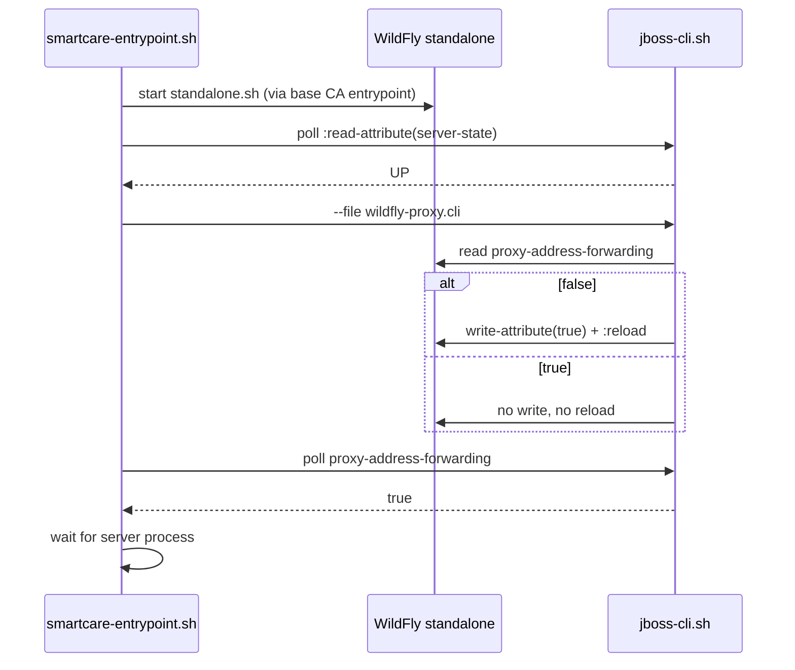

# 06 — WildFly proxy forwarding (idempotent startup wiring)

## Goal
- Make WildFly understand that the browser connected over HTTPS through nginx, so `request.getScheme()` / `getRemoteAddr()` reflect the original client.
- Apply the setting from a versioned CLI script at container startup, without a one-off `docker exec`, and prove it survives recreation.

## Plain-language explanation
- nginx talks plain HTTP to WildFly, so WildFly would otherwise think every request is `http://` and comes from the Docker gateway.
- Undertow's `proxy-address-forwarding` attribute tells it to trust the standard `Forwarded`, `X-Forwarded-Proto` and `X-Forwarded-For` headers set in B3.
- The CLI script first **reads** the attribute. It writes only when the value is `false`, then reloads only when running in a real `STANDALONE` server. In embedded/config-only mode it skips the reload.
- A small entrypoint waits for the management API, runs the CLI script, tolerates the expected disconnect caused by `:reload`, waits until the attribute reads `true`, and only then hands traffic to the server process.



## Why it is needed here
- B4 makes the cookie `Secure`; B3 forwards `X-Forwarded-Proto: https`. Without this step WildFly would still generate absolute URLs and security decisions from the internal HTTP scheme.
- The WildFly container already exists and is on a different Docker network; D6 forbids moving it to nginx's network in Phase B.
- `CLI_LAUNCH_SCRIPT` in the upstream image cannot run operations that restart the server, so a dedicated entrypoint is required to satisfy the "then reload" decision.

## Prerequisites
- Docker Engine with the `quay.io/wildfly/wildfly:42.0.0.Final-jdk25` image available locally (verified).
- No need to stop the legacy `smartcare-nginx` on 8081/8082.
- Ports for a test container must be free: this verification used 8085 (HTTP) and 9995 (management) to avoid colliding with the existing deployment.
- B3 nginx config already sends `X-Forwarded-Proto`, `X-Forwarded-For`, `X-Forwarded-Host`, `X-Forwarded-Port`.

## Procedure
1. Review `scripts/wildfly-proxy.cli`. It targets:
   `/subsystem=undertow/server=default-server/http-listener=default` and attribute `proxy-address-forwarding`.
2. Review `scripts/wildfly-entrypoint.sh` and `docker/Dockerfile.wildfly-proxy`. The image also sets `SMARTCARE_SESSION_SECURE=true` from B4.
3. Build the HTTPS-profile image from the repository root:

   ```powershell
   docker build -f docker/Dockerfile.wildfly-proxy -t smartcare-wildfly-proxy:local .
   ```

4. Test on non-conflicting ports:

   ```powershell
   docker run -d --name smartcare-wildfly-proxy-test `
     -p 8085:8080 -p 9995:9990 `
     -e SMARTCARE_SESSION_SECURE=true `
     smartcare-wildfly-proxy:local
   ```

5. Watch startup:

   ```powershell
   docker logs -f smartcare-wildfly-proxy-test
   ```

   Expected on first boot: `operation-requires-reload`, a short server stop/start, `Proxy CLI returned non-zero; verifying final state.`, then `SmartCare WildFly proxy forwarding verified.`

6. Verify the runtime value and environment:

   ```powershell
   docker exec smartcare-wildfly-proxy-test `
     /opt/jboss/wildfly/bin/jboss-cli.sh --connect `
     --command='/subsystem=undertow/server=default-server/http-listener=default:read-attribute(name=proxy-address-forwarding)'
   docker exec smartcare-wildfly-proxy-test printenv SMARTCARE_SESSION_SECURE
   ```

   Expected: `"result" => true` and `true`.

7. Prove idempotence/recreation safety:

   ```powershell
   docker restart smartcare-wildfly-proxy-test
   docker logs smartcare-wildfly-proxy-test 2>&1 | Select-String 'Already configured|proxy forwarding verified'
   ```

   Second boot should print `Already configured or embedded mode: no reload required.` and **not** print `operation-requires-reload`.

8. To use this image for the real lab WildFly later (Phase C cutover, not this step), replace the existing container with one built from this image and the same volume/deployment setup. Do not do that while validating legacy 8081/8082.
9. Paste the `docker build`, first-boot, second-boot and CLI outputs into `docs/https-pwa/evidence/2026-11-21-wildfly-proxy.txt`.
10. Clean up the test container with `docker rm -f smartcare-wildfly-proxy-test`.

## Files created or modified
- `scripts/wildfly-proxy.cli` — idempotent read/write/reload CLI script.
- `scripts/wildfly-entrypoint.sh` — waits for management API, runs CLI, verifies final state, forwards signals.
- `docker/Dockerfile.wildfly-proxy` — derived image with scripts, `SMARTCARE_SESSION_SECURE=true`, explicit `CMD`.
- `docs/https-pwa/06-wildfly-proxy.md` — this step document.
- `docs/https-pwa/evidence/2026-11-21-wildfly-proxy.txt` — build/startup evidence.
- `docs/decisions/ADR-0007-wildfly-startup-config.md` — startup wiring decision.
- `docs/https-pwa/README.md`, `docs/https-pwa/14-troubleshooting.md`, `docs/CHANGELOG.md` — index/troubleshooting/log updates.

## Verification
- **VERIFIED 2026-11-21** in a disposable container:
  - `docker build -f docker/Dockerfile.wildfly-proxy -t smartcare-wildfly-proxy:test .` → build succeeded.
  - First boot with `-e SMARTCARE_SESSION_SECURE=true` → `operation-requires-reload` appeared, CLI returned non-zero after the reload disconnect, entrypoint verification printed `SmartCare WildFly proxy forwarding verified.`
  - CLI read-back → `{"outcome" => "success", "result" => true}`.
  - `printenv SMARTCARE_SESSION_SECURE` → `true`.
  - `docker restart` → second boot printed `Already configured or embedded mode: no reload required.` and final verification again; no new `operation-requires-reload`.
  - Embedded CLI test with `embed-server` → `result => true`, no reload attempted.
- **UNVERIFIED**: real `smartcare-wildfly` container replaced with this image; that is Phase C cutover to keep legacy HTTP working until verification passes.

## Troubleshooting

| Problem | Likely cause | Fix |
| --- | --- | --- |
| Container exits immediately with no logs | `ENTRYPOINT` overridden without restoring `CMD`. | Keep `CMD ["/opt/jboss/wildfly/bin/standalone.sh","-b","0.0.0.0"]` in the Dockerfile. |
| `Proxy CLI returned non-zero` | Expected when `:reload` drops the CLI connection. | Let the entrypoint verify `proxy-address-forwarding=true`; only fail if verification times out. |
| `proxy-address-forwarding is not true; refusing to serve traffic` | CLI target address changed in another WildFly version, or management auth. | Check the resource path with `jboss-cli.sh --commands='embed-server, /subsystem=undertow:read-children-names(child-type=server)'`. |
| `address already in use` on 8080/9990 | Touched the real WildFly ports. | Use test ports 8085/9995 until Phase C; do not stop `smartcare-wildfly` during Phase B. |
| Cookie still not Secure | Image env not set or old container running. | `printenv SMARTCARE_SESSION_SECURE`; recreate from `Dockerfile.wildfly-proxy`. |

Also appended to [14-troubleshooting.md](14-troubleshooting.md).

## Security notes
- The derived image sets `SMARTCARE_SESSION_SECURE=true` only for this HTTPS profile; the legacy image/container keeps the default false.
- Trusting forwarding headers is safe only while nginx is the sole ingress. Do not expose WildFly's 8080 publicly; ADR-0005 keeps it host-published for now.
- No admin credentials are baked into the image; management interface remains the image default.
- The entrypoint fails closed: if the attribute cannot be verified, the container exits instead of serving misconfigured traffic.
- `rootCA-key.pem` and the nginx leaf key are never copied into this image.

## Rollback
- `docker rm -f smartcare-wildfly-proxy-test` removes the test container; the legacy WildFly was never changed.
- Delete `scripts/wildfly-proxy.cli`, `scripts/wildfly-entrypoint.sh`, `docker/Dockerfile.wildfly-proxy` and remove the local image if abandoning B5.
- To undo the setting inside a running test container: `jboss-cli.sh --connect --command='/subsystem=undertow/server=default-server/http-listener=default:write-attribute(name=proxy-address-forwarding,value=false)'` then `:reload`.

## Decisions and alternatives
- Accepted [ADR-0007](../decisions/ADR-0007-wildfly-startup-config.md): custom derived image + entrypoint.
- Alternative: upstream `CLI_LAUNCH_SCRIPT` — rejected because docs say restart-implying operations are unsupported and D5 requires reload.
- Alternative: one-off `docker exec jboss-cli.sh ...` — rejected; not reproducible and lost on recreation.
- Alternative: bake with `embed-server` at build time — useful for config-only edits, but D5 requires the reload path and runtime verification; kept only as an embedded-mode test.

## References
- WildFly image docs — `CLI_LAUNCH_SCRIPT`: https://docs.wildfly.org/wildfly-images/#cli_launch_script
- WildFly management CLI guide — if/else: https://docs.redhat.com/en/documentation/red_hat_jboss_enterprise_application_platform/7.4/html/management_cli_guide/creating_executing_requests
- WildFly Undertow subsystem docs: https://docs.wildfly.org/42/Admin_Guide.html#Undertow
- Docker `ENTRYPOINT` vs `CMD`: https://docs.docker.com/reference/dockerfile/#entrypoint
